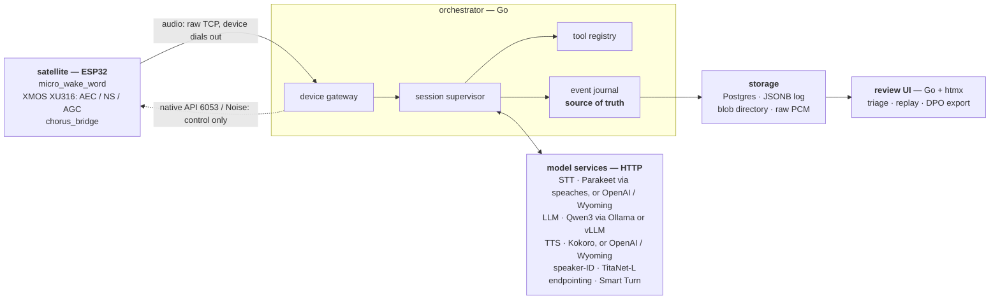

# Chorus

**Your voice assistant shouldn't go deaf while it talks.**

Barge in. Bring someone else into the conversation. Walk into another room.
Chorus keeps up.

It replaces Home Assistant's Assist pipeline for ESP32 voice satellites
(FutureProofHomes Satellite1, HA Voice Preview Edition). Assist has three hard
limits: it can't speak and act at the same time, interruption loses the
conversation, and its trace data is too thin to learn from.

- **Full duplex.** The mic never stops, even during playback. Interrupt
  mid-sentence and the turn is truncated at the byte the speaker actually
  played — not at the byte the model sent.
- **Knows who said what.** A speaker embedding per utterance, so when someone
  else chimes in, Chorus re-attributes the turn *inside* the same conversation.
- **Follows the person, not the device.** The conversation belongs to whoever is
  talking; the audio stream belongs to the satellite. Wake on another satellite
  and pick the same thread back up.
- **Everything is replayable.** The orchestrator is a pure reducer over an
  append-only event log. Tracing isn't instrumentation; it *is* the runtime.
  Every barge-in produces a preference pair, and `replay()` is a tested
  function.

Built for one household, 2–10 satellites, and local models. Chorus isn't a Home
Assistant integration; Home Assistant is one tool backend among several.

## Status

**Phase 1 is built, and phase 2 is under way** ([SPEC §14](docs/SPEC.md#14-phase-plan)).
`cmd/chorusd` runs the device bridge, session engine, and event journal
together as the orchestrator daemon, and runs a Satellite1 in the house on
protocol 4 firmware, under Docker Compose. Running it there is what found
the television opening sessions; a spoken wake now has to match an enrolled
household voice. What exists today:

| Piece | State |
|---|---|
| `cmd/chorusd` — the orchestrator daemon: accepts satellites, one session supervisor per link over a shared journal, holds each device's native API open and drives its LED ring and speaker volume | runs a Satellite1 in the house, under Docker Compose; under test against the in-process satellite |
| `internal/esphome` — native API client, Noise transport | dials real hardware |
| `internal/bridge` — the audio link, which authenticates both ends before any audio and seals every frame (protocol 4), and `bridgetest`, the in-process satellite that is the primary test asset | under test; full duplex proven on hardware (§3.3.2), and the protocol 4 handshake runs against a Satellite1 |
| `internal/session` — actor/supervisor, speech channel, barge-in gate, hot phrases, what the ring shows | under test |
| `internal/journal` — append-only log on Postgres, `replay()` | under test |
| `internal/satellite` — renders speech onto a device; the truncation point is the DAC's; canned lines from audio built into the binary until the voice answers | under test |
| `internal/blob` — the audio a journal event refers to, and the free-space floor below which it is not written | under test |
| `internal/retention` — prunes audio and logs by each satellite's horizon, and the deletion path the review UI shares | under test; the Postgres delete path in the db tier |
| `internal/ops` — `chorusd`'s `/healthz`, `/readyz` and `/metrics` on loopback | under test |
| `esphome/components/chorus_bridge` — firmware component, with the on-device "Hey Eddie" wake word, a Speaker Volume number, the HAT's mute switch and the ring's Muted and Error effects | flashed onto a Satellite1, which completes the protocol 4 handshake with `chorusd`; validated by `esphome config` and its handshake MAC on the host |
| `esphome/voice-pe.yaml` — the Home Assistant Voice PE, wired from its stock firmware: the same bridge, wake word, ring effects, Speaker Volume (which its dial turns) and mute switch as the Satellite1, and a centre button that wakes it | validated by `esphome config`; not compiled or flashed (ADR-0073) |
| `cmd/probe` — connect to a satellite and dump what it exposes | works |
| LLM — `internal/provider/ollama`, the turn engine | dials a real endpoint; asked again with each tool result and the conversation so far |
| LLM — `internal/provider/vllm`, the turn engine on vLLM with `CHORUS_LLM_PROVIDER=vllm`: each call dispatched as its arguments close, each speak call's words streamed as they arrive (ADR-0077) | under test against streams in vLLM's shape and through the daemon; not yet run against a real vLLM server |
| TTS — `internal/provider/kokoro`, resampled to the device's rate | dials a real endpoint; `sidecars/kokoromlx` serves the same contract from the GPU on Apple Silicon, a clause in 0.21 s (ADR-0092) |
| STT — `internal/stt` partials over `internal/provider/speaches` | measured against real Parakeet TDT 0.6B v2 on CPU |
| TTS and STT — `internal/provider/openai` and `internal/provider/wyoming`, with `CHORUS_TTS_PROVIDER` / `CHORUS_STT_PROVIDER`: any server with OpenAI's audio API, or Home Assistant's Wyoming piper and whisper, resampled to the device's rate by `internal/provider/pcm` (ADR-0081) | under test against servers in their shape; not yet run against a real one |
| speaker-ID — `internal/identity` over `internal/provider/speakerid` and `sidecars/speakerid` (TitaNet-L on ONNX) | thresholds measured on 37 speakers; sidecar runs without Docker |
| `cmd/enroll` — adds, lists and removes the household's voiceprints in `identities.yaml` | under test; enrolls from WAV files through the speaker-ID sidecar |
| endpointing — `listen.Semantic` over `internal/provider/smartturn` and `sidecars/smartturn` (Smart Turn v3.2 on ONNX) | ends a turn ~340 ms after the last word on CPU; right on 76 of 88 synthetic household takes, not yet measured on recorded speech |
| `internal/hass` — the one real tool (SPEC §14 item 5) | verified against Home Assistant 2026.10; unlocking a door or disarming the alarm waits for a yes from whoever asked |
| `internal/listen` — the Listening child: mic stream to utterances, barge-in candidates, attribution, and the arbiter that lets only the loudest of several satellites answer one wake | under test |
| `internal/timer`, `internal/announce` — timers that go off where they were set, and announcements to other rooms, answerable with no wake word | under test; timers survive a restart |
| `internal/volume` — `set_volume`: a satellite's speaker level, by level or step, in the turn's room or one named | under test |
| `internal/memory` — what each person asked to be remembered, and a summary of each conversation for the people in it | under test |
| `internal/harvest`, `cmd/harvest` — barge-ins as DPO candidates, and the dataset export (format 2) | under test |
| `internal/contexts` — the text of every prompt and tool-schema version, filed by the hash the journal records | under test; a test recomputes every hash |
| `cmd/reviewui` — Browse, Triage, Review, Replay, Curate, Export, Arbitration, Memory, Voices and Deletions over the journal, on loopback unless told otherwise ([guide](docs/reviewui/README.md), [demo](https://teagan42.github.io/Chorus/demo/)) | under test, in a headless Chrome too |
| `internal/triage` — barge-ins, failures, repeated asks, slow answers and speaker flips, derived on read | under test |
| `internal/rerun` — edit-and-replay: a conversation's turns asked again under another prompt or model | under test |
| `internal/provider/mcp` — the household's MCP servers' tools, offered as `mcp_<server>_<tool>` under conservative policy fixed at startup, with `CHORUS_MCP_CONFIG` (ADR-0075) | under test against MCP servers in process, over stdio and Streamable HTTP |
| `internal/evalsuite`, `cmd/chorus-eval` — journalled turns replayed under a candidate prompt, model and tool set, scored against a baseline; exits 1 on a regression ([guide](docs/eval.md), ADR-0079) | under test; `task eval:demo` runs the seed suite with a scripted model |
| wake retraining — `internal/tools/wakecorpus` and `internal/tools/waketrain`: "Hey Eddie" retrained from the rejected wakes, shipped only when it beats the deployed model ([guide](docs/wake-retraining.md), ADR-0078) | tested up to training; no model trained by it yet |
| `internal/curation` — a reviewer's verdicts, in a table beside the journal | under test |
| `internal/erasure` — the trail of what a reviewer deleted, by id and count, never content | under test |

`task spec` reports which spec clauses have tests behind them.

## Architecture



Polyglot by seam: Go where it's a concurrent socket server, Python where the
ecosystem is Python. No shoehorning either direction. The model services are
off-the-shelf servers behind small Go clients in `internal/provider`; the two
Chorus owns are the speaker-ID and Smart Turn sidecars in `sidecars/`. SPEC §10
is the stack and its alternatives.

The device is the TCP server and the controller is the client, so Chorus dials
out — `aioesphomeapi` is the reference implementation. Audio cannot ride the
native API without forking `api.proto`, which is why `chorus_bridge` opens its
own socket. Stock `voice_assistant` is removed from the device YAML entirely.

## Install

Needs Go 1.27+, [`uv`](https://docs.astral.sh/uv/) for the Python sidecars, and
Docker for the journal database. Everything else — `buf`, `cue`, `gofumpt`,
`golangci-lint` — is pinned and installed by `task tools`.

```sh
go install github.com/go-task/task/v3/cmd/task@v3.54.0

git clone git@github.com:Teagan42/Chorus.git
cd Chorus
task tools      # pinned toolchain into GOPATH/bin, plus the git hooks
task check      # lint + codegen drift + tests + doc examples + spec trace
```

`task check` is the gate. It runs in seconds and is identical in CI. If it
passes, you have a working clone.

## Running

Spoken wake sessions require an enrolled household voice so television audio
cannot open a session. See [voice enrollment](docs/voice-enrollment.md) for
the one-time setup.

### Against the fake satellite

The hermetic test suite needs no hardware, no GPU, and no network. The fake
satellite (`internal/bridge/bridgetest`) speaks the real `chorus_bridge`
framing in-process, and the native API client is tested over an in-memory
pipe with the real Noise handshake:

```sh
task test
```

Concurrency and interrupt timing are where this project's bugs live, and they
cannot be tested repeatably against hardware. That makes the fake the primary
test asset rather than a convenience.

### Against a real satellite

Flash the firmware, then point the probe at it.

```sh
cd esphome
cp secrets.example.yaml secrets.yaml      # wifi, api encryption key, OTA password
cd ..

task firmware:config                      # validate before flashing
task firmware:compile                     # downloads ESP-IDF on first run
task firmware:upload                      # over the air
```

`firmware:upload` flashes what the last `firmware:compile` built and does
not compile, so compile after every change. The device asks for
`ota_password` before it accepts a flash. The audio link is protocol 4
(ADR-0074), and a host refuses a satellite on any other, so **reflash every
satellite whenever the host moves to a new protocol**, in step with it.

`satellite1.yaml` is the real FutureProofHomes Satellite1 wiring and is what
the firmware tasks build by default. Set `orchestrator_host` in it to the
machine running the orchestrator — a literal IP on a static lease, because
ESPHome cannot resolve hostnames for an outbound socket.

A Voice PE builds from `voice-pe.yaml` the same way, named after the task:
`task firmware:compile -- voice-pe.yaml`, then `firmware:upload` with the
same argument. Every device YAML reads the one `secrets.yaml`, so satellites
built from it share an API key unless you change it between builds; each
satellite's `psk` in `devices.yaml` is whatever its build used.

**Do not flash `satellite1.example.yaml`.** Its I²S pins are generic ESP32-S3
placeholders, there so the file validates standalone — they are not any real
board's wiring. It exists to exercise the config schema, not to run.

Then describe the device to the host side:

```sh
cp devices.example.yaml devices.yaml       # gitignored; psk is the base64 api key
task probe -- -listen 10s
```

Each satellite's `name` in `devices.yaml` must be the node name the device
reports, MAC suffix included (`satellite1-4b2c10`), and its `address` the
IP it dials from: the audio link's handshake proves that name under that
`psk`, and refuses a connection from anywhere else.

`probe` completes the Noise handshake, prints the device info and entity list,
and then streams incoming messages for as long as you asked. It is the phase-1
spike: proof the connection can be owned without Home Assistant.

### The journal database

```sh
task db:up        # Postgres, waits until healthy
task test:db      # the db-tagged tier
task db:down      # stop, keep the volume
```

### Run the orchestrator

The daemon reads the satellite inventory from `devices.yaml` and everything
else from the environment, which `task run` loads from a gitignored `.env`.

```sh
task db:up                                # the journal; migrations run at startup
cp .env.example .env                      # model endpoints, blob directory, HA token
task run                                  # go run ./cmd/chorusd
```

It fails at startup naming every variable that is missing. The speaker-ID
sidecar starts optional but answers nothing without it: a session opens only
for an enrolled household voice, so with `SPEAKERID_URL` unset, or nobody
enrolled, every wake, a button press included, is rejected as
`unknown_speaker`; enroll through `task enroll` or the review UI's Voices
screen ([guide](docs/voice-enrollment.md)). Smart Turn and Home Assistant are
optional and say so in the log when absent: without Smart Turn every turn ends
after 800 ms of quiet (ADR-0036); without Home Assistant the `ha_*` tools
answer `not_implemented`, which the model sees. Unset, `CHORUS_MCP_CONFIG`
offers no MCP server's tools (ADR-0075); `mcp.example.yaml` shows the file. Point
`orchestrator_host` in the device YAML at this machine, and the satellites
dial in on port 6055 and prove who they are before any audio.
`docker compose up -d chorusd reviewui` runs the daemon and live review UI as
services beside the database. Open `http://127.0.0.1:8080`; Compose publishes
the UI on host loopback only. It shares the journal and audio volume with
`chorusd`, and Replay reaches host Ollama at `host.docker.internal:11434`.
The satellite still needs `orchestrator_host` set to the Docker host's
reachable LAN IP (not a Compose service name); the bridge dials port 6055.
Docker Desktop rewrites the inbound source IP, so `audio_source_ip` in
`devices.yaml` maps that gateway address to the satellite. The native API still
uses the device's real LAN address, and the bridge handshake checks its name
and PSK.

The model services start locally one task each: `task stt:up`, `task tts:up`,
`task speakerid:up` and `task smartturn:up` (or `task speakerid:serve` and
`task smartturn:serve` without Docker). On an Apple Silicon Mac `task
tts:serve` renders the voice on the GPU instead, a clause in 0.21 s against the
CPU image's 0.56-0.92 (ADR-0092). Ollama is yours to run.
`CHORUS_TTS_PROVIDER` and `CHORUS_STT_PROVIDER` swap Kokoro and speaches for
any server with OpenAI's audio API or Home Assistant's Wyoming piper and
whisper (ADR-0081); `.env.example` lists each one's variables.

### Enroll the household

Speaker identification is only as good as who is enrolled: until someone is,
every voice is a guest, person-scoped tools stay closed, and the barge-in
gate cannot tell the household from the television (ADR-0031). `enroll`
writes `identities.yaml`, gitignored beside `devices.yaml`, which is where
`chorusd` looks for it. Each person records at least three guided phrases
as WAV, 16 kHz mono 16-bit PCM, the satellite's own format; nothing is
resampled, because the thresholds were measured on that audio.

```sh norun
task speakerid:up                         # the sidecar the phrases embed through
task enroll -- add -id teagan -name "Teagan"     -wav one.wav -wav two.wav -wav three.wav
task enroll -- list                       # id, name, how many phrases; never the vectors
task enroll -- remove -id teagan
```

`task enroll` reads `SPEAKERID_URL` from the same `.env` as `task run`
(`-speakerid-url` overrides it), and `-identities PATH` names another file.
The file records the sidecar's model, so a person embedded under a different
model than the file already holds is refused rather than matched as noise.
`chorusd` reads the household at startup only: restart it after every
change, and the command says so.

The review UI's Voices screen (`/voices`, below) does the same from a
browser: it lists the household, enrolls someone from uploaded takes or ones
recorded on the page, and removes them, writing the same file.

### Review what happened

```sh
task reviewui                             # http://127.0.0.1:8080, same .env
```

The review UI reads the journal and the blob directory `chorusd` writes:
browse the day per satellite, triage what's worth a look, listen to each
barge-in cut where the speaker actually stopped, re-run a conversation under
an edited prompt, curate the pairs, and download the dataset. It also reads
and forgets what the house remembers about each person, and deletes a
conversation or a clip, keeping a line of what went (ADR-0070).

It has no login and plays every recording in the house, so it listens on
loopback unless told otherwise: `task reviewui -- -addr :8080 -hosts
review.home` opens it to the LAN by the names people will type, and it
refuses a request addressed to any other. `-read-only` (or
`CHORUS_REVIEWUI_READ_ONLY=true`) hides and refuses every deletion, for a
reviewer who should label but not delete.
[`docs/reviewui/README.md`](docs/reviewui/README.md) walks every screen, and
the [demo](https://teagan42.github.io/Chorus/demo/) runs it in your browser
over a made-up household's Thursday.
`task harvest -- <conversation-id>` writes one conversation's raw candidates
from the command line: every barge-in, uncurated, with no `chosen` side
(`meta.curated=false`), so it is for inspection, not training. The curated
dataset comes from the Export screen.

### Retention

Retention deletes nothing until `devices.yaml` says how long to keep it.
Horizons are days; absent or `0` keeps forever. A satellite's own block
overrides the house's, horizon by horizon:

```yaml
retention:          # the house
  audio: 30d        # the PCM a log names
  journal: 365d     # a conversation, after its last event
  prune_curated: false
satellites:
  - name: kitchen
    # ...
    retention:
      audio: 7d
```

`chorusd` prunes at startup and hourly. A clip past its satellite's audio
horizon is deleted and its log says `audio_dropped`, so the review UI shows
*audio pruned* where the player was. A conversation goes whole once its
journal horizon has passed, and the device and house logs lose their oldest
events. What a reviewer accepted, edited, labelled, promoted or confirmed is
kept unless `prune_curated` is true, and a live session is never touched.
Separately, below `CHORUS_BLOB_MIN_FREE_MIB` (1024 by default) free on the
blob directory's disk, audio is not written; the turn goes on, and the log
says the clip was not kept. [ADR-0065](docs/adr/0065-retention-prunes-by-each-satellites-horizon-and-records-what-it-drops.md)
has the rules.

### Watching it run

`chorusd` serves three endpoints on `CHORUS_OPS_LISTEN`, `127.0.0.1:6056`
by default (`off` turns them off). Nothing there asks who is asking, so it
stays on loopback unless you choose otherwise; `docker compose` publishes it
on the host's loopback only.

```sh norun
curl -s localhost:6056/healthz            # the process and its probe loop; calls nothing
curl -s localhost:6056/readyz | jq        # each dependency and each satellite
curl -s localhost:6056/metrics            # Prometheus text
```

`/readyz` answers 503 while Postgres, STT, TTS or the LLM is down, and 200
with `"status": "degraded"` while only speaker ID, Smart Turn, Home
Assistant or a satellite is: the house still answers without those, and a
restart would not bring a satellite back. Each satellite shows whether its
audio link and native API are connected and when it last sent a frame.
Dependencies are probed every 15 s in the background, so a hung sidecar
never holds the request. `/metrics` counts what the journal records as it
is written (sessions, barge-ins, model and voice failures, tool calls, the
first-audio wait) beside the blob disk, the satellites and each
dependency. The compose healthcheck is `chorusd -healthcheck`, since the
image has no shell. [ADR-0068](docs/adr/0068-chorusd-serves-health-readiness-and-metrics-derived-from-the-journal-on-loopback.md)
has the metric names and why OpenTelemetry waits.

## Tests

Seven tiers, separated because six of them cannot run everywhere. `task check`
is the gate; the others are what the gate can't demand of every machine.

| Task | Needs | Runs |
|---|---|---|
| `task test` | nothing | hermetic suite, included in `task check` |
| `task test:db` | Postgres (`task db:up`) | separate CI job, every push |
| `task test:e2e` | Chrome or Chromium (`CHORUS_E2E_CHROME`) | separate CI job, every push |
| `task test:sidecars` | `uv`; fetches the two pinned sidecar models | separate CI job, every push |
| `task firmware:test` | a C++ compiler and mbedTLS | the firmware CI job, every push |
| `task test:models` | GPU sidecars | self-hosted runner: nightly, on dispatch, or a PR labelled `ci:self-hosted` |
| `task test:hardware` | a real satellite | self-hosted runner: nightly, on dispatch, or a PR labelled `ci:self-hosted` |

Hermetic means hermetic: no network, no wall clock, no GPU, no device. A test
that reaches the network is a bug in the test.

## Documentation

All of it, searchable, at **[teagan42.github.io/Chorus](https://teagan42.github.io/Chorus/)**.
The site is these same files, rebuilt and republished on every push to `main`.

| Where | What |
|---|---|
| [`docs/SPEC.md`](docs/SPEC.md) | Normative. Tests cite the clause they verify. |
| [`docs/adr/`](docs/adr/) | Every architectural decision, and why each one went that way. |
| [`docs/reference/`](docs/reference/) | Generated from the CUE schemas — events, tools. |
| [`docs/reviewui/`](docs/reviewui/README.md) | The review UI: running it, every screen, its browser tests. |
| [`docs/voice-enrollment.md`](docs/voice-enrollment.md) | Enrolling the household's voices, without which no wake opens a session. |
| [`docs/eval.md`](docs/eval.md) | Eval suites: scoring a candidate prompt or model against journalled turns. |
| [`docs/wake-retraining.md`](docs/wake-retraining.md) | Retraining "Hey Eddie" from the wakes the host rejected. |
| [`docs/hardware/`](docs/hardware/README.md) | The Chorus main board under the Satellite1 HAT: its design, and the XMOS firmware for four raw mics. |
| [`esphome/README.md`](esphome/README.md) | The `chorus_bridge` wire protocol. |
| [`sidecars/speakerid/README.md`](sidecars/speakerid/README.md) | The speaker-ID sidecar and its embed contract. |
| [`sidecars/smartturn/README.md`](sidecars/smartturn/README.md) | The Smart Turn sidecar and its end-of-turn contract. |
| [`CHANGELOG.md`](CHANGELOG.md) | Every release, written by release-please. |
| [`CONTRIBUTING.md`](CONTRIBUTING.md) | Five rules. Read before the first PR. |

Docs are build artifacts or they are executed: `task test:docs` extracts and
runs the code examples, `task spec:check` fails on a test citing a spec
clause that no longer exists or a §15 clause no test covers, and `task
docs:build` fails on a link, anchor, or screenshot that no longer exists.

## Contributing

Tests first — a bug gets a failing fixture before a fix. Schemas are the source
of truth, so generated types and docs are never hand-edited. Commits are atomic:
generated, dependency, formatting, and behavior changes never share one.
[`CONTRIBUTING.md`](CONTRIBUTING.md) has the detail, and `task check` enforces
what it can.
